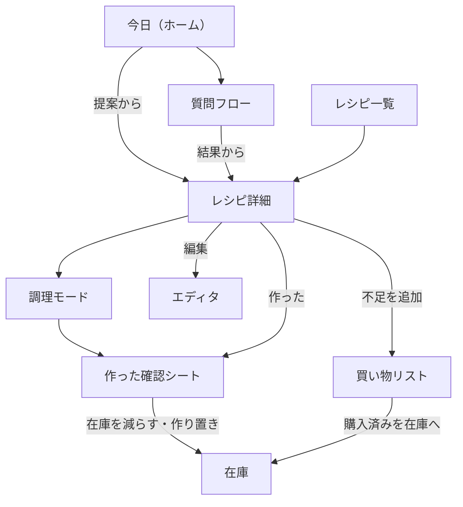

# Cella Penaria 仕様書

> この文書は claude.ai 上の仕様書（共同編集用）をリポジトリに写したもの。実装で仕様を変えたら、このファイルを同じ作業の中で更新する（CLAUDE.md ルール8）。

要件定義をもとに、実装できる粒度の仕様に落とし込む。アプリ名は Cella Penaria（ラテン語で「食料の貯蔵庫」）、リポジトリ名は cella-penaria。数値は初期値で、使いながら調整する前提とする（src/config）。

## 技術スタック

AIが安定して書けることと、GitHub Pagesだけで動くことを基準に選んだ。

| 用途 | 採用 | 理由 |
| --- | --- | --- |
| 言語・ビルド | TypeScript、Vite | 型でデータ仕様を表せる。ビルドが速く設定が少ない |
| UI | React | AIが書くコードの安定度と参考情報が最も多い |
| スタイル | Tailwind CSS | 見た目が各画面のファイル内で完結し、修正箇所を探しやすい |
| データベース | Dexie.js | IndexedDBを扱いやすくし、データの変化を画面へ自動で反映できる |
| PWA | vite-plugin-pwa | Service Workerとmanifestを生成する |
| 画面遷移 | ハッシュ方式のルーティング（`#/recipes` など） | GitHub Pagesは途中のURLで再読み込みすると404になるため |
| ドラッグ操作 | dnd-kit | 手順とスロットの並べ替え |
| テスト | Vitest | domain のロジックを中心にテストする |
| 公開 | GitHub Actions → GitHub Pages | main への push でビルドして公開する |

### その他の決定

- 期限の通知は入れない。GitHub Pagesだけでは通知を送るサーバーがないため、アプリを開いたときにホームで確認する
- 栄養計算のたんぱく質・脂質・炭水化物は、成分表の同名の列を使う。食品パッケージの栄養表示と同じ考え方で、値が欠けている食品も少ないため
- スロット間の組み合わせ除外ルールは、開発フェーズ6以降に後回しにする
- 本書の数値は初期値のまま始め、使いながら src/config で調整する

## 画面遷移

下部4タブを起点に、どの入口からもレシピ詳細に届き、「作った」で在庫に戻る。食材追加シートと設定はどの画面からでも開けるため、図からは省いている。



エディタはレシピ詳細の編集ボタンのほか、レシピ一覧の新規作成ボタンと設定のマスタ編集からも開く。

## 画面仕様

全画面共通で、下部に4タブ（今日・在庫・レシピ・買い物）、右下に食材追加のフローティングボタン（FAB）、ヘッダー右上に設定アイコンを置く。下部タブとFABはエディタ、調理モード、質問フロー、設定では隠す。

### 共通部品

- 食材追加シート：FABから下からせり上がるシートで開く。上段によく使う食材チップ（直近30日の追加回数順、最大12件）、中段に検索欄、下段に検索結果
    - 検索欄に読点「、」「,」を含む文字列を入力して確定すると、まとめて追加モードになる（ロジック仕様の表記揺れ正規化で照合）
    - マスタにない名前は「＋『〇〇』を新規登録」を結果の末尾に出す。タップで食材マスタの簡易登録（名前・カテゴリ・管理タイプ）を開く
    - 食材を選ぶと保管場所・状態・期限の確認行が出る。初期値はマスタの既定値で、そのまま「追加」で確定できる
- 元に戻すバー：削除・状態変更の直後に画面下部へ5秒間表示する。押すと直前の操作を取り消す
- 空状態：一覧が空のときは、短い説明1行と、次にすべき操作のボタン1つだけを表示する

### 今日（ホーム）

- 表示：期限が近い食材のカード（期限切れ・今日・明日の件数と食材名）、それらを使うレシピ提案（最大5件）、「質問で探す」「食材から探す」の入口ボタン
- 提案の並びはロジック仕様の既定のおすすめ順に従う
- 期限が近い食材がない日は、最近作っていないレシピから3件を出す

### 在庫

- 上部のセグメントで「冷蔵庫」と「調味料・ストック」を切り替える
- 冷蔵庫ビュー：期限管理の在庫と作り置きを、期限区分（期限切れ／今日・明日／今週／余裕あり／期限なし）の見出しでまとめて期限昇順に表示。保管場所チップ（すべて・冷蔵・冷凍・野菜室・常温）で絞り込む
- 調味料・ストックビュー：残量管理の在庫を保管場所ごとにまとめ、各行に「ある／少ない／ない」の切り替えを置く。「少ない」「ない」の行は先頭に寄せる
- 行の操作：右スワイプで「使い切り」、左スワイプで「廃棄」。タップで編集シート（個数、状態、期限、保管場所、削除）
- 残量を「少ない」「ない」にしたとき、該当食材が買い物リストになければ元に戻すバーに「買い物リストへ」ボタンを並べる

### レシピ一覧

- 上部に検索欄と並べ替え（おすすめ順・最近作っていない順・名前順）
- 各行：写真サムネイル、料理名、照合結果（作れる／代用で作れる／あと◯品）、作れる組み合わせ数、所要時間
- 右下のボタンでレシピ・パーツを新規作成（FABの役割をこの画面だけ差し替える）
- 「おまかせ」ボタン：現在の表示候補からランダムに1件を選び、そのレシピ詳細を開く

### 質問フロー

- 入口は「質問で探す」（全レシピから）と「食材から探す」（食材選択画面を挟む）の2つ
- 食材選択画面：在庫を期限順に並べ、期限区分が「期限切れ」「今日・明日」の食材を選択済みにして表示する。選んだ食材をすべて使うレシピに候補を絞る
- 質問画面：ヘッダーに戻る・残り候補数、上部にこれまでの回答チップ、中央に質問文と選択肢（各件数つき）、「どちらでもいい」、下部に「この時点で◯件を見る」「おまかせ」
- 回答チップをタップすると、その質問からやり直す
- 終了条件を満たすと結果一覧（レシピ一覧と同じ行表示）に移る

### レシピ詳細

- 上から：写真、料理名・所要時間、前回の調理メモ（あれば）、人数ステッパー、スロットごとの選択チップ、栄養（1人分の主要6項目、タップで内訳）、材料、手順、「調理モード」「作った」ボタン
- 材料はベースとスロットごとの見出しで区切る。各行の先頭に在庫状態アイコン（あり・代用可・なし）
- 「なし」「代用可」の行をタップすると、代用の説明と「買い物リストへ」ボタンを展開する
- 材料が足りない選択肢のチップは点線枠で表示する
- ヘッダー右上に編集ボタン

### 調理モード

- 全画面表示で1ステップずつ表示する。左右スワイプまたは下部の大きな「前へ」「次へ」で移動
- 画面のスリープを防ぐ（対応端末のみ。非対応時は何もしない）
- 所要時間を持つステップは「◯分タイマー」ボタンを表示する。タイマーは複数同時に動かせ、画面上部に残り時間を並べる。終了時は画面全体を点滅させる
- 最後のステップの「次へ」は「作った」に変わる

### 作った確認シート

- 選択中の組み合わせで使った食材を一覧し、食材ごとに減算内容を選ぶ（ロジック仕様の在庫減算）
- 「残りを作り置きとして登録」チェック（初期値オフ）。オンにすると期限（初期値は今日＋2日）を表示
- 「次回へのメモ」1行入力（任意）
- 「記録する」で在庫減算・調理履歴保存・作り置き登録を一括で行い、元に戻すバーを出す

### 買い物リスト

- カテゴリ順に見出しでまとめる。各行にチェックボックス、食材名、追加元の小さなラベル（レシピ名など）
- 上部に追加欄（読点区切りでまとめて追加可）、ヘッダーに共有ボタン
- チェック済みが1件以上あるとき、下部に「◯件を在庫に登録」ボタンを出す。押すと各食材をマスタの既定値で在庫に追加し、リストから外す
- 共有はチェックされていない項目をカテゴリ順に「・食材名」の改行区切りテキストにして、端末の共有画面に渡す。共有画面が使えない端末ではクリップボードにコピーする

### エディタ

- レシピ編集：基本情報（名前・人数・時間・写真・メモ）、タグ（軸ごとのチップ）、ベース材料、手順、スロット、代用の上書きを縦に並べる。幅768px以上では左に入力、右にプレビューの2カラム
- 材料行：食材（マスタ補完）、数量、単位（候補選択）、表示テキスト（空なら数量と単位から自動生成）、任意フラグ
- 手順行：本文、所要時間（分、任意）、並べ替えハンドル。スロットの差し込み位置は手順の間に置く「スロット：◯◯」行としてドラッグで動かす
- スロット：名前、選択肢（パーツ検索で追加）、既定の選択肢、「なし」を許可
- パーツ編集：種類、名前、材料、手順、タグ（partTaggable の軸だけ）
- 食材マスタ編集：名前、別名、カテゴリ、既定保管場所、管理タイプ、期限目安、単位換算の行、成分表の紐づけ（名前で検索して選択）、代用ルールの行
- タグ軸編集：軸の名前、質問文、値の一覧、質問に使うかどうか、軸の並び順
- 手間（valueSource が minutes の軸）はタグとして入力させず、レシピの所要時間から自動で決める
- 保存は明示的な「保存」ボタン。未保存で離れようとしたら確認する（エディタだけは元に戻すバーではなく確認を使う）

### 設定

- 同期：Googleアカウントとの連携・解除、最終同期日時、「今すぐ同期」
- データ：JSONエクスポート、JSONインポート（既存データとマージ）、データ保護の状態と使用容量
- マスタ類：食材マスタ、タグ軸、保管場所、カテゴリ（並び順＝売り場順）の編集画面への入口
- 表示：テーマ（端末に合わせる・ライト・ダーク）

## データ仕様

同期対象のレコードはすべて `SyncMeta` を持ち、日付は `YYYY-MM-DD` の文字列、日時はUNIXミリ秒で保存する。IDはUUID v4（初期データだけは固定ID）。

### 型定義

型の正は [src/data/types.ts](../src/data/types.ts)。主要な形は次のとおり。

```ts
interface SyncMeta {
  id: ID;
  updatedAt: number;         // 最終更新（ms）。初期データは 0
  deletedAt: number | null;  // 論理削除（ms）
  deviceId: string;          // 最終更新した端末
}

type TrackingType = 'expiry' | 'quantity';   // 期限管理 | 残量管理
type Level = 'enough' | 'low' | 'none';        // ある | 少ない | ない

interface Ingredient extends SyncMeta {
  name: string; aliases: string[]; categoryId: ID; defaultLocationId: ID;
  tracking: TrackingType;
  shelfLifeDays: number | null;                         // 期限目安。null＝期限なし
  unitConversions: { unit: string; grams: number }[];   // 可食部の重さ
  foodCode: string | null;                              // 成分表の食品番号
  substitutes: Substitute[];
}

interface Substitute {
  id: ID;
  items: { ingredientId: ID; amountText: string }[];    // 組み合わせ可。一方向
  note: string;
}

interface StockItem extends SyncMeta {
  kind: 'ingredient' | 'leftover';                      // 食材 | 作り置き
  ingredientId: ID | null; label: string | null;        // leftover は label に料理名
  sourceRecipeId: ID | null; locationId: ID;
  count: number | null;                                 // 個数で持つ場合
  level: Level;                                         // 個数で持たない場合の状態
  expiresOn: DateStr | null; addedOn: DateStr;
}

interface IngredientLine {
  id: ID; ingredientId: ID;
  displayText: string;                                  // 例「1/2束」
  amount: number | null; unit: string | null;           // 計算用
  optional: boolean;
}

interface Step { id: ID; text: string; minutes: number | null; }
type StepEntry = { type: 'step'; step: Step } | { type: 'slot'; slotId: ID };
interface Slot { id: ID; name: string; optionPartIds: ID[]; defaultPartId: ID | null; allowNone: boolean; }
type Tags = Record<ID, ID[]>;                            // 軸ID → 値ID（複数可）

interface Part extends SyncMeta {
  kind: string; name: string; ingredients: IngredientLine[]; steps: Step[]; tags: Tags;
}

interface Recipe extends SyncMeta {
  name: string; servings: number; minutes: number | null; imageId: ID | null; memo: string;
  ingredients: IngredientLine[];                        // ベース
  entries: StepEntry[];                                 // 手順とスロット差し込み位置
  slots: Slot[]; tags: Tags;
  overrides: { ingredientId: ID; rule: 'noSubstitute' | 'omittable' | 'substitute'; substitute?: Substitute }[];
}

interface TagAxis extends SyncMeta {
  name: string; question: string;
  values: { id: ID; name: string; maxMinutes?: number | null }[];
  askable: boolean;
  order: number;
  valueSource: 'manual' | 'minutes';                    // minutes＝所要時間から自動で決める
  partTaggable: boolean;                                // パーツにも付けられるか
}

interface ShoppingItem extends SyncMeta {
  ingredientId: ID | null; freeText: string | null;
  source: 'manual' | 'recipe' | 'stock'; sourceRecipeId: ID | null; checked: boolean;
}

interface CookLog extends SyncMeta {
  recipeId: ID; selectedPartIds: (ID | null)[]; servings: number; cookedOn: DateStr; note: string;
}

interface Location extends SyncMeta { name: string; order: number; }
interface Category extends SyncMeta { name: string; order: number; }   // order＝売り場順
interface ImageMeta extends SyncMeta { width: number; height: number; bytes: number; uploaded: boolean; }
```

### IndexedDBのストア

DB名は `cella-penaria`。スキーマは Dexie.js の version 定義（src/data/migrations.ts）で管理し、変更時は新しい version を追加する。boolean はインデックスにできないため、checked や uploaded は全件読み込んでから絞り込む。

| ストア | キー | インデックス | 同期 |
| --- | --- | --- | --- |
| ingredients | id | name, updatedAt | 対象 |
| stock | id | ingredientId, expiresOn, locationId, updatedAt | 対象 |
| parts | id | updatedAt | 対象 |
| recipes | id | updatedAt | 対象 |
| tagAxes | id | order | 対象 |
| shopping | id | updatedAt | 対象 |
| cookLogs | id | recipeId, cookedOn | 対象 |
| locations / categories | id | order | 対象 |
| imageMeta | id | updatedAt | 対象 |
| imageBlobs | id | ― | 別ファイルで同期 |
| thumbBlobs | id | ― | 対象外（端末で生成） |
| foods | code | key | 対象外（同梱データ） |
| settings | key | ― | 対象外（端末ごと） |

`settings` には deviceId、最終同期日時、Driveのファイル情報、テーマなど端末固有の値だけを置く。

### 初期データ

初回起動時に保管場所（冷蔵・冷凍・野菜室・常温・調味料棚）、カテゴリ（野菜・果物・肉・魚介・卵・乳製品・豆腐・大豆製品・加工品・主食・乾物・調味料・その他）、タグ軸（位置づけ・主役・ジャンル・気分・調理法・手間・温度）を投入する。IDは固定値（loc-fridge、axis-genre など）、updatedAt は 0 で投入し、端末ごとに投入したデータが同期で二重にならないようにする。値と質問文の一覧は src/data/seed.ts を正とする。

| 軸 | 質問 | 値 | パーツに付けられる |
| --- | --- | --- | --- |
| 位置づけ | 何を作る？ | 主菜／副菜／汁物／主食／一品で完結 | いいえ |
| 主役 | 何を食べたい？ | 肉／魚介／野菜／卵・大豆製品 | いいえ |
| ジャンル | どこの料理？ | 和食／洋食（日本式）／イタリアン／フレンチ／スペイン・地中海／中華／韓国／東南アジア／インド・中東／メキシコ・中南米／その他 | はい |
| 気分 | どんな気分？ | さっぱり／ふつう／こってり | はい |
| 調理法 | どう作る？ | 焼く・炒める／煮る／揚げる／蒸す・レンジ／和える・生 | はい |
| 手間 | 時間はどれくらい？ | 15分以内／30分くらい／じっくり（所要時間から自動） | いいえ |
| 温度 | 温かいのと冷たいの、どっち？ | 温かい／冷たい | はい |

## ロジック仕様

ロジックはすべて画面から独立した純粋な関数として実装し（src/domain）、IndexedDBから読み込んだデータを引数に取る。レシピ数百件の規模なら毎回全件を計算し直してよく、キャッシュは持たない。

### 期限区分

今日との差の日数 d = expiresOn − 今日 で区分する。

| 区分 | 条件 |
| --- | --- |
| 期限切れ | d < 0 |
| 今日・明日 | 0 ≤ d ≤ 1 |
| 今週 | 2 ≤ d ≤ 6 |
| 余裕あり | d ≥ 7 |
| 期限なし | expiresOn が null |

「期限が近い」は期限切れと今日・明日を指す。期限の初期値は 今日 ＋ shelfLifeDays。

### 在庫の有無

食材ごとに「あり／なし」を次の規則で決める。同じ食材の在庫が複数あれば、どれか1つがありなら「あり」。

- 期限管理：count が1以上、または count が null で level が none 以外の在庫があれば「あり」。期限切れの在庫も「あり」に含め、画面で警告表示する
- 残量管理：level が none の在庫があれば「なし」。在庫レコードが存在しない場合は「あり」とみなす（明示されたときだけ不足扱い）
- 作り置き（leftover）は照合に使わない

### 組み合わせの展開

1. 各スロットの選択肢を並べる。allowNone なら「なし」を選択肢に加える
2. 全スロットの直積を組み合わせとする。上限は256通りで、超えた分は既定の選択肢に近い順に打ち切る
3. 組み合わせの必要食材 ＝ ベースの材料 ＋ 選んだパーツの材料 のうち optional でないもの。同じ食材は1つにまとめる

### 在庫照合

組み合わせごとに、必要食材を1つずつ判定する。

1. 在庫が「あり」なら OK
2. レシピの上書きが omittable なら OK（省略）
3. 上書きが noSubstitute なら NG
4. 上書きが substitute ならその代用、そうでなければ食材マスタの代用ルールを順に見て、items の全食材が「あり」のものがあれば SUB（代用）
5. いずれでもなければ NG

組み合わせの結果は、NG が0件かつ SUB が0件なら「作れる」、NG が0件なら「代用で作れる」、それ以外は「足りない（NG件数）」。レシピの結果は、組み合わせの中で最も良い結果とし、「作れる」組み合わせの数を添える。

### 既定のおすすめ順

1. 照合結果の良い順（作れる → 代用で作れる → 足りない件数の少ない順）
2. 期限が近い在庫を使う食材数の多い順
3. 最後に作った日が古い順（作ったことがないものを最優先）

「最近作っていない順」は3だけで並べる。

### 質問の軸選択

候補レシピの集合を R とする。レシピ r が軸 a の値 v に「合う」とは、r のいずれかの組み合わせで、レシピのタグとパーツのタグを合わせた集合に v が含まれることとする。軸 a にタグを持たないレシピは、その軸のどの値にも合うとみなす。valueSource が minutes の軸は、所要時間が maxMinutes 以下になる最初の値に合うとみなす（所要時間がないレシピはどの値にも合う）。パーツのタグは partTaggable の軸だけを使う。

回答済みでなく askable な各軸 a について、値 v ごとに合う件数 n(a, v) を数え、次を満たす軸の中から最大件数が最も小さい軸を選ぶ。

- 最大件数 max_v n(a, v) が |R| より小さい（全候補が同じ値の軸は聞かない）
- 件数が1以上の値が2つ以上ある

同点なら TagAxis の order が小さい軸を選ぶ。件数0の値は選択肢に出さない。

- 回答 v を選んだら R を v に合うレシピに絞る。「どちらでもいい」は R を変えずに、その軸を回答済みにする
- |R| ≤ 5、または条件を満たす軸がなくなったら結果一覧に移る
- 結果からレシピを開くと、回答をすべて満たす組み合わせのうち照合結果が最も良いものを既定で選ぶ

### 表記揺れの正規化

照合用のキーは次の順で作る（src/domain/normalize.ts）。食材マスタの name と aliases、料理名すべてに適用する。

1. Unicode NFKC 正規化（全角英数・半角カナを統一）
2. カタカナをひらがなに変換
3. 英字を小文字に変換
4. 空白、中黒「・」、長音以外の記号を除去

検索は完全一致、前方一致、部分一致の順に並べる。まとめて追加は「、」「,」「，」と改行で分割し、各語を完全一致→前方一致の順で照合する（src/domain/bulk-parse.ts）。一致しない語は新規登録候補として確認画面に並べる。

### 分量の換算

人数を s から s' に変えたとき、倍率 k = s' ÷ s を数量に掛ける。表示の丸めは単位で変える。

| 単位 | 丸め |
| --- | --- |
| g、ml | 5単位（5未満は1単位） |
| 大さじ、小さじ、カップ | 1/4刻みで分数表示 |
| 個、本、枚、片など | 1/2刻み |
| 数量なし | 表示テキストの後ろに「×k」を添える（k は小数第1位まで） |

### 栄養計算

各材料のグラム数 g を求め、成分表の可食部100gあたりの値 c に掛けて合計し、人数 s' で割る。

1人分 ＝ (1 / s') × Σ (g_i / 100 × c_i)

- g は単位が g のときは数量そのもの、それ以外は食材マスタの unitConversions で換算し、倍率 k を掛ける
- 数量が null、換算がない、foodCode が null の材料は計算から外し、「一部未計算」として食材名を内訳に表示する
- 表示項目：エネルギー（kcal）、たんぱく質、脂質、炭水化物、食物繊維、食塩相当量（g）。小数第1位まで。たんぱく質・脂質・炭水化物は成分表の同名の列を使う
- 調理による変化は考慮せず、生の値で計算する

### 作ったときの在庫減算

作った確認シートに、選択中の組み合わせで使った在庫ありの食材を並べ、食材ごとに初期値を決める。

| 在庫の持ち方 | 選択肢 | 初期値 |
| --- | --- | --- |
| 個数（count） | 減らす数のステッパー | 単位が個・本・枚なら換算後の数量を切り上げ、それ以外は1 |
| 状態（level） | 使い切った／少し残った／変わらない | 使い切った |
| 残量管理 | 変わらない／少ない／ない | 変わらない |

- count が0になった在庫、「使い切った」を選んだ在庫は論理削除する
- 「少ない」「ない」にした残量管理の食材は、買い物リストに source = 'stock' で追加する（既にあれば追加しない）
- 作り置きを登録する場合は、kind = 'leftover'、label = 料理名、保管場所 = 冷蔵、期限 = 指定日で在庫に追加する
- 一連の変更は1つのトランザクションで書き込み、元に戻すバーで一括して取り消せるようにする

### 買い物リストの並び

カテゴリの order 昇順、同じカテゴリ内は追加した順。freeText の項目は「その他」に入れる。

## 同期仕様

Google Driveのアプリ専用領域（appDataFolder）に、テキストデータ1ファイルと画像を1枚1ファイルで置く。マージはレコード単位の更新日時の比較だけで行い、サーバー側の処理は持たない。

### Drive上のファイル

| ファイル名 | 中身 | 更新 |
| --- | --- | --- |
| data.json | 同期対象ストアの全レコード | 同期のたびに上書き |
| img-{画像ID}.webp | 画像本体 | 作成のみ。書き換えない |

```json
{
  "schemaVersion": 1,
  "writtenAt": 1791800000000,
  "writtenBy": "device-uuid",
  "records": {
    "ingredients": [], "stock": [], "parts": [], "recipes": [],
    "tagAxes": [], "shopping": [], "cookLogs": [],
    "locations": [], "categories": [], "imageMeta": []
  }
}
```

schemaVersion は src/data/migrations.ts の `DATA_SCHEMA_VERSION`。

### 認証

- Google Identity Services のトークンクライアントで、スコープ drive.appdata のアクセストークンを取得する
- トークンと有効期限を localStorage に保存し、有効期限内ならアプリを開き直しても再利用する（個人用のため、端末内保存のリスクは許容する）
- 期限切れのときは自動同期を行わず、設定アイコンに未同期の印を出す。認証のポップアップはユーザー操作から開く必要があるため、再認証は「今すぐ同期」のタップで行う
- 「連携解除」でトークンを破棄し、Googleにも取り消しを送る

### 同期のタイミング

- アプリ起動時、およびバックグラウンドから戻ったときに、前回の同期から5分以上経っていれば実行
- 設定の「今すぐ同期」
- データ変更時の自動送信は行わない（同時実行や通信量を避けるため）

### 同期の手順

1. 同期中フラグを立てる。既に同期中なら何もしない
2. imageMeta のうち uploaded = false の画像を img-{ID}.webp としてアップロードし、成功したものを uploaded = true にする
3. data.json を取得し、そのときの Drive 上の更新日時を控える。ファイルがなければ空として扱う
4. 取得した schemaVersion がアプリより新しければ、同期を中止して「アプリを更新してください」と表示する
5. ストアごとにマージする（下記）
6. マージ結果を IndexedDB に1トランザクションで書き込む
7. data.json の Drive 上の更新日時を再取得し、3で控えた値と違えば3からやり直す（最大3回）。同じならマージ結果をアップロードする
8. 参照されているのに手元にない画像を、バックグラウンドで順にダウンロードする。表示中の画面で必要な画像は先に取得する
9. 参照されていない画像の掃除（下記）を行い、最終同期日時を保存する

### マージ規則

- 同じ id のレコードは updatedAt が新しい方を採用する。同じ値なら deviceId の文字列比較で大きい方を採用する
- 片方にしかないレコードはそのまま採用する
- 論理削除されたレコードも同じ規則で扱う。これにより削除が他の端末に伝わる
- deletedAt から180日を過ぎたレコードは、マージ後に両方から物理削除する
- 端末の時計のずれは考慮しない（個人の端末同士で、ずれは小さい前提）

### 画像の掃除

- どのレシピの imageId からも参照されない画像を「孤立」とし、初めて孤立を検出した日時を settings に記録する
- 孤立が7日以上続いた画像だけを Drive と端末から削除する。再び参照されたら記録を消す
- 7日の猶予は、他の端末が画像を先にアップロードし、まだ data.json を書いていない状態での誤削除を防ぐため

### エラー時

- 通信エラーや Drive API のエラーでは、手元のデータを変えずに同期を中断し、設定画面に失敗日時と理由を表示する
- 次の同期タイミングでそのまま再実行する。手元のデータは常に有効なので、同期の失敗でアプリの利用は妨げない

### JSONエクスポートとインポート

- エクスポートは data.json と同じ形式に画像を含めないファイルを書き出す
- インポートは同期と同じマージ規則で取り込む（上書きではない）

## 画像処理仕様

写真は端末内で長辺1280pxのWebPに変換して保存・同期し、一覧用のサムネイルは各端末で生成して同期しない。

| 種類 | 長辺 | 品質 | 保存先 | 同期 |
| --- | --- | --- | --- | --- |
| 本画像 | 1280px | 0.8 | imageBlobs | img-{ID}.webp として同期 |
| サムネイル | 240px | 0.7 | thumbBlobs | しない（本画像から生成） |

1. 写真をカメラまたはファイル選択で受け取る（`<input type="file" accept="image/*">`）
2. `createImageBitmap` で読み込み、EXIFの向きを反映する
3. 長辺が上限を超える場合だけ縮小する（拡大はしない）。縮小は段階的に半分ずつ行い、画質の劣化を抑える
4. canvas の `toBlob('image/webp', 品質)` で書き出す。結果の MIME が image/webp でなければ（ブラウザがWebPの書き出しに非対応の場合）、WebAssembly版のエンコーダで変換し直す
5. ImageMeta（幅・高さ・バイト数、uploaded = false）と本画像を保存し、続けてサムネイルを生成する

- WebAssembly版エンコーダは初回の利用時に読み込み、Service Worker でキャッシュする
- 写真の差し替えは新しいIDで保存し、レシピの imageId を付け替える。古い画像は画像の掃除で消える
- サムネイルがない画像（他の端末から同期した直後など）は、表示時に本画像から生成する

## PWA仕様

アプリ本体と成分表データをインストール時にすべてキャッシュし、以後はネットワークなしで起動できるようにする。GitHub Pagesのリポジトリ配下（`/cella-penaria/`）で動く前提で、パスはすべて相対で書く。

### manifest

| 項目 | 値 |
| --- | --- |
| name / short_name | Cella Penaria |
| start_url / scope | `./` |
| display | standalone |
| orientation | portrait |
| theme_color / background_color | ライトテーマの背景色 |
| icons | 192px・512px・maskable 512px |

iOS向けに apple-touch-icon（180px）を別途置き、viewport に `viewport-fit=cover` を指定する。manifest は vite.config.ts で定義する。

### キャッシュ戦略

| 対象 | 戦略 |
| --- | --- |
| HTML・JS・CSS・アイコン | インストール時に事前キャッシュ。バージョンごとにキャッシュ名を分ける |
| 成分表データ（foods.json） | 事前キャッシュ。初回起動時に IndexedDB の foods ストアへ展開する |
| WebP エンコーダ（wasm） | 初回利用時にキャッシュ |
| Google の認証・Drive API | キャッシュしない（常にネットワーク） |

### 更新

- 新しい Service Worker が待機状態になったら、画面下部に「新しいバージョンがあります」と「更新」ボタンを出す
- 「更新」で待機中の Service Worker を有効化し、ページを再読み込みする。勝手には切り替えない（調理中に画面が変わるのを避けるため）
- 成分表データのバージョンが変わった場合は、再読み込み後に foods ストアを入れ替える

### データの保全

- 初回起動時に `navigator.storage.persist()` を呼び、ブラウザによるデータの自動削除を避けるよう要求する
- 設定画面に、永続化の可否と使用容量（`navigator.storage.estimate()`）を表示する

### 端末機能

| 機能 | 使うAPI | 非対応時 |
| --- | --- | --- |
| 調理中のスリープ防止 | Screen Wake Lock。画面が非表示から戻るたびに取り直す | 何もしない |
| 買い物リストの共有 | Web Share | クリップボードにコピー |
| 写真の取り込み | ファイル入力（カメラ起動を含む） | ― |

### 画面の安全領域

下部タブと FAB は `env(safe-area-inset-bottom)` の分だけ持ち上げ、ヘッダーは `env(safe-area-inset-top)` の分だけ下げる。タップ領域は最小44×44pxとする。

## 成分表データ変換仕様

文部科学省が配布する[日本食品標準成分表（八訂）増補2023年](https://www.mext.go.jp/a_menu/syokuhinseibun/mext_00001.html)の第2章データ（Excel）を、リポジトリ内の変換スクリプトで foods.json に変換して同梱する。変換は開発時に手元で実行し、アプリ内では行わない。

- 置き場所：`tools/build-foods/`（入力Excelは `tools/build-foods/input/` に置き、リポジトリに含めない。出力の public/foods.json だけをコミットする）
- 抽出する列：食品番号、食品群、食品名、エネルギー（kcal）、たんぱく質、脂質、炭水化物、食物繊維総量、食塩相当量
- 値の変換：数値はそのまま、「Tr」（微量）は0、括弧付きの推定値は括弧を外して数値、「-」（未測定）は null
- 食品名は検索用に正規化したキーも持たせる（表記揺れの正規化と同じ処理）
- 出力にデータの版（「八訂増補2023」など）と配布ファイルの日付を含め、アプリ側の入れ替え判定に使う。2026年3月27日付で正誤表が公開され配布データも更新されているため、変換には最新の配布ファイルを使う
- 利用条件は配布元のサイトの記載に従い、設定画面に出典を表示する

```json
{
  "version": "8th-2023",
  "foods": [
    { "code": "11221", "group": 11, "name": "＜鳥肉類＞ にわとり ［若どり・主品目］ もも 皮つき 生", "key": "...",
      "kcal": 0, "protein": 0, "fat": 0, "carb": 0, "fiber": 0, "salt": 0 }
  ]
}
```

上の数値は形式を示すための仮の値。食品番号と食品名の対応も、変換時に元データで確認する。

## 未決事項

- [ ] 保管場所・カテゴリの初期値の確定（雛形には src/data/seed.ts の案を投入済み）
- [ ] アイコンのデザイン（雛形は仮のアイコン）
